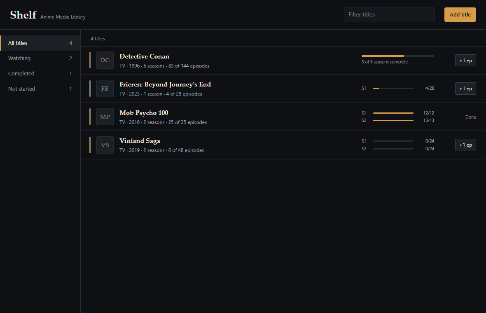

# Anime Media Library

A local anime watch log. One window, one SQLite file, no account and no network calls.

You add a title, give it seasons, and log episodes. A title shows as **Watching** once any
episode is logged, **Completed** when every season is finished, and **Not started** before
that. Stopping mid-season is a first-class case: set the last episode you watched and the
shelf remembers it.



## What it does

- Catalog of titles with year, format and notes.
- Seasons per title, each with an episode count and episodes watched.
- Quick `+1 ep` from the shelf, or set any episode number in the detail panel.
- Derived status per title, so nothing drifts out of sync.
- Filters: all, watching, completed, not started. Title search.
- Everything stored in a local SQLite database. Deleting a title deletes its seasons.

## Stack

| Layer | Choice |
|---|---|
| Shell | Tauri 2 (WebView2 on Windows) |
| UI | React 19, TypeScript, Vite |
| Storage | SQLite through `tauri-plugin-sql`, migrations declared in Rust |

## Run it

Prerequisites: Node 20+, pnpm, Rust (stable MSVC toolchain), and the platform Tauri
dependencies (on Windows: MSVC Build Tools and WebView2).

```powershell
pnpm install
pnpm tauri dev
```

Build an installer:

```powershell
pnpm tauri build
```

## Where the data lives

One SQLite file, `anime-library.db`, in the app config directory. On Windows that is
`%APPDATA%\com.hardtek.animemedialibrary\`. Copy that file to back up the library.

## Schema

```sql
CREATE TABLE anime (
  id         INTEGER PRIMARY KEY AUTOINCREMENT,
  title      TEXT    NOT NULL CHECK (length(trim(title)) > 0),
  year       INTEGER CHECK (year BETWEEN 1900 AND 2100),
  format     TEXT    NOT NULL DEFAULT 'TV'
                     CHECK (format IN ('TV', 'Movie', 'OVA', 'ONA', 'Special')),
  notes      TEXT,
  created_at TEXT    NOT NULL DEFAULT (datetime('now'))
);

CREATE TABLE season (
  anime_id         INTEGER NOT NULL REFERENCES anime(id) ON DELETE CASCADE,
  number           INTEGER NOT NULL CHECK (number > 0),
  episode_count    INTEGER NOT NULL CHECK (episode_count > 0),
  episodes_watched INTEGER NOT NULL DEFAULT 0 CHECK (episodes_watched >= 0),
  PRIMARY KEY (anime_id, number),
  CHECK (episodes_watched <= episode_count)
);
```

Status is computed from `season`, never stored, so there is no column to fall out of date.
Episode counts are clamped in SQL, which means an out of range value cannot be written even
if the UI is bypassed.

## Design

The interface is a dark shelf: ink and bone, one amber accent, serif titles, and a thin
spine per row whose colour is derived from the title. Details and the reasoning are in
[DESIGN.md](DESIGN.md).

## Verified

Checked in the running app on Windows (WebView2 155), not only in a browser:

- First launch creates the schema and shows the empty state with the add action.
- Adding a title with one season and 3 of 28 episodes saved it as Watching.
- `+1 ep` took that season from 3/28 to 4/28 and the count survived a reload.
- Setting the last episode of the final season moved the title to Completed, and the rail
  count followed.
- Filters and search: Watching, Completed and the empty result state each show the right
  rows; searching a title narrows the list to it.
- An empty title and a zero episode count are both refused, with the message inside the
  panel.
- Delete asks for confirmation, then removes the title and its seasons.
- Escape closes the detail panel.
- A six season title renders as one aggregate bar instead of six strips, and every row
  stayed 69 px tall with four titles on screen.
- `pnpm tauri build` produced a working bundle, and the packaged executable opened the same
  library from the same database file.

## Not included

No metadata API, no cover downloads, no sync, no ratings, no import or export. The app is
deliberately offline: the only file it touches is its own database.

## Development notes

- `src-tauri/migrations/` holds SQL applied at startup. Add a new numbered file and a
  matching `Migration` entry in `src-tauri/src/lib.rs` instead of editing an applied one.
- Database capabilities live in `src-tauri/capabilities/default.json`, which grants load,
  select, execute and close on the app's own database.
- `src-tauri/tauri.debug.conf.json` is a development-only config that opens the WebView2
  debugging port on 9222 and marks the window title. Run it with
  `pnpm tauri dev --config src-tauri/tauri.debug.conf.json`. The shipped config leaves the
  port closed.
